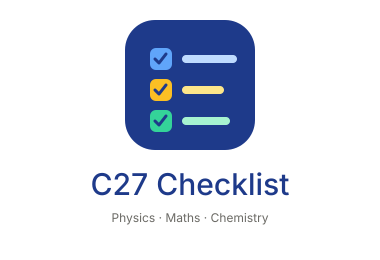

# C27 Lecture Checklist

A tick-off checklist for the Bakliwal Tutorials C27 Evening COC + Champions batch (7 Sep to 25 Oct 2026): Physics, Maths, Chemistry and the Grand BTest. Progress is saved in your browser (localStorage).

## Run locally
The page loads `lectures.json` with `fetch`, so serve the folder over http:

    python3 -m http.server 8000

Then open http://localhost:8000

## Deploy on GitHub Pages
1. Push this folder to a GitHub repo.
2. Settings → Pages → Deploy from branch → `main` / root.

## Edit lectures
Change dates or tags in `lectures.json`. No build step.

## Structure
- `index.html`, `style.css`, `app.js`: the page
- `lectures.json`: lecture data
- `logo.svg`, `assets/logo.svg`, `assets/icon.svg`: logo and favicon (the header logo is inlined in `index.html`, so it shows even if `assets/` is missing)
- `manifest.webmanifest`: lets the page be installed on a phone

## Install on Android
Deploy this folder at the root of a GitHub Pages site (HTTPS). Open the published site in Chrome, wait a few seconds, then use the visible **Install App** button if it appears, or Chrome menu → Install app / Add to Home screen. If the site was already opened before these changes, close its tab and reopen the published URL.
